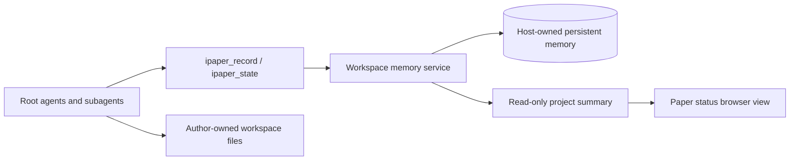

# IPaper Shared Research Memory

This design reference defines the simplified target architecture for IPaper. The current implementation uses a Paper Project Graph with typed nodes, edges, and process lenses; the shared-memory model below is not yet implemented. Current package behavior is documented in the [package README](../packages/dsh-ipaper/README.md#architecture).

## Core decision

Each workspace has one durable research memory shared across its sessions. Agents record sources, findings, and notes that are useful beyond the current conversation. Manuscripts, figures, bibliographies, project instructions, and working plans remain ordinary author-owned workspace files.

The memory helps agents recover context and trace findings to their origins. It does not attempt to model the complete scholarly process or enforce a paper-writing workflow.

## Ownership

- The singleton host service owns workspace resolution, persistence, validation, and concurrent access. All sessions in a workspace reach the same memory.
- The `ipaper` preset owns the two agent tools and concise recording instructions.
- Workspace files hold the actual paper and working plan. Memory references those files without becoming another document store.
- The Paper status browser view reads through the host service. Browser-local state is not authoritative research data.
- Upstream Web continues to own startup, transport, and the shared shell. APaper remains a separate profile-root extension.

## Three record kinds

| Kind | What to record |
| --- | --- |
| `source` | A paper, dataset, website, or other research source, with available identifiers and a description of what was actually inspected |
| `finding` | An observation, quotation, result, or tentative claim, with its origin and any uncertainty |
| `note` | Durable context, an unresolved question, or a useful explanation that does not fit the other kinds |

Each record has a host-assigned ID, project membership, title, text, kind, version, timestamps, and creating/updating session attribution. Records can be archived without deleting their history.

Sources distinguish discovery from inspection. Their optional DOI, URL, citation key, and bibliographic metadata describe the source; possessing an identifier does not mean that its content or metadata has been verified.

Findings state uncertainty in plain text. A finding may be an unsupported hypothesis, but it must be described as such. A direct quotation requires a source or file reference and a precise locator. Recording a finding does not certify that it is true.

### References rather than a graph vocabulary

Records can contain three small forms of reference:

- **Origin:** a source record or workspace file, with an optional page, section, or other locator. Findings use this to explain where their content came from.
- **Related record:** another record in the same project, with an optional explanation of the relationship.
- **Workspace file:** a workspace-relative path connecting research memory to a draft, figure, dataset, or other output.

References are stored with the record. There is no separate edge catalog, required root connectivity, or automatic containment relationship. Missing files are reported as missing; a path reference neither creates a file nor proves its contents were inspected.

## Two tools

The tool names remain stable. Their simplified inputs and outputs require an implementation change; existing graph payloads are not the target contract.

### `ipaper_record`

Creates or updates a small batch of records and returns their IDs, versions, and the committed project revision. New records may reference each other through call-local aliases. Updating or archiving an existing record requires its expected version; a conflict requires reading the current record before retrying.

A root agent can create, update, and archive records. Subagents can append records and reference existing records, but cannot change existing records. The host derives these permissions from trusted caller context. Subagents do not need a task node or `taskId` to contribute.

Agents record durable discoveries and meaningful corrections, rather than mirroring every message, file edit, or task step into memory.

### `ipaper_state`

Reads the current workspace memory through four small views:

| View | Result |
| --- | --- |
| Summary, the default | Record counts, recent additions, and notes or findings explicitly marked as unresolved by their authors |
| Search | Paginated records filtered by kind and text |
| Record | One record, its references, and bounded referencing records |
| History | Paginated changes for one record or the project |

Detailed records are loaded only when needed. There are no process lenses, inferred stage statuses, or global completion scores. The exact machine-readable tool schemas belong with the implementation.

## Host guarantees

The service creates project metadata on the first read or write. The project is a storage scope, not a record agents must maintain. Workspace resolution uses trusted session context and parent lineage when needed; callers cannot select an arbitrary project through tool arguments.

The host enforces:

- valid record shapes and unique, resolvable batch aliases;
- same-project record references;
- workspace-contained file paths;
- locators and origins for records explicitly presented as direct quotations;
- caller permissions and expected-version checks;
- all-or-nothing batch visibility and recovery after interrupted writes.

Writes serialize per project. A successful batch advances the project revision once and records internal change history with caller attribution. History is not a record kind that agents create or connect. The service remains the only storage access boundary, including for browser reads. Storage remains single-host unless cross-process coordination is implemented separately.

These guarantees validate structure and attribution. They do not establish that a quotation is accurate, a source supports a finding, or a research result is correct. Agents must inspect the underlying material and state verification gaps. IPaper's prohibition on fabricated citations, quotations, metadata, data, and results continues to apply.

Removing a workspace registration does not delete its files or research memory. Adoption, export, and destructive deletion require separate explicit designs.

## Why this is smaller

The graph design requires agents to maintain objectives, requirements, tasks, evidence, claims, artifacts, reviews, and decisions together with their statuses and relationships. That bookkeeping competes with the research and writing itself.

The replacement keeps durable context and provenance while moving planning and revision discussion into ordinary documents. It gives up automatic process-lens derivation and graph-enforced scholarly transitions. Questions such as “is this argument adequately supported?” remain review work, informed by inspectable references rather than inferred from a status flag.

Reliable persistence, version checks, and attribution remain necessary even with a smaller data model. Their implementation details stay behind the service boundary.

## Migration from the graph

The implementation transition must preserve existing work and update the service, tools, preset protocol, browser view, and product documentation together.

1. Introduce a versioned memory format and a restart-safe migration. Preserve the original graph and its history as a recoverable legacy snapshot.
2. Map source nodes to sources, evidence and claim nodes to findings, and note nodes to notes. Preserve original IDs in migration metadata and retain uncertainty and source inspection information.
3. Preserve objectives, requirements, tasks, artifacts, reviews, and decisions as notes with their original kind, status, and attributes. Carry artifact paths into file references. Moving planning content into author-owned documents is a later explicit edit, not an automatic overwrite.
4. Convert provenance edges into origin references where representable. Preserve other semantic edges as related-record references with their original relationship names. Keep event nodes in legacy history and project roots in project metadata.
5. Replace graph-specific tool schemas and prompts together. Existing graph payloads must receive a clear compatibility error or pass through an explicit versioned adapter; never silently reinterpret them.
6. Adapt Paper status to the memory read contract and remove its dependency on graph lenses. Update both READMEs when the simplified behavior ships.

Completion requires checks for shared workspace identity, subagent attribution and append-only permissions, reference and path validation, version conflicts, interrupted-write recovery, bounded reads, and migration without lost legacy content. Package-composition and shipped-artifact changes also require the repository's typecheck, test, and package checks.

## Extension boundary

Citation verification, manuscript editing, compilation, and report generation can consume memory and workspace files through public host contracts. They do not require more record kinds or a second source of truth. Add structured fields only when a concrete feature needs them; do not rebuild the workflow graph in optional metadata.
